# scan-to-markdown

Дословно переносит сканы бумажных документов (PDF с фотографиями страниц — анализы, заключения, выписки, договоры, счета) в Markdown. Сделан для документов, где важна каждая цифра. Поэтому ни одно место текста не держится на одном мнении: его подтверждают независимые чтения, код и в конце человек.



Схема в редактируемом виде — [docs/process.tldr](docs/process.tldr) (открывается на tldraw.com: Menu → Open file).

## Кто что делает

- **Читатель A** (Claude Fable 5.1) переписывает страницу целиком. **Читатель B** (Claude Opus 5.5) переписывает её же по горизонтальным полосам. Друг друга они не видят.
- **Apple Vision** (распознавание текста, встроенное в macOS) текст не пишет. Он только сообщает, какие символы видит и где, — это контролёр чисел.
- **Код** сравнивает A и B. Любое различие в числах, словах, знаках, границах ячеек таблицы или пометках сомнения становится спорным местом. Число, которое оба прочитали одинаково, но которого Vision не видит в той же строке, тоже идёт на проверку. Исключение — служебное (печати, реквизиты, сертификаты, колонтитулы): там двух согласных чтений достаточно.
- **Арбитр** (Claude Fable 5.1, максимальная глубина размышлений) смотрит на скан только в спорных местах и выбирает: верно у A, верно у B, на скане иначе или не читается. Служебные места решает быстро, без разбора печатей. Текст он не переписывает: итог собирает код из текста A и решений арбитра. Заметки читателей и арбитра о странице видны на странице сверки.
- **Ты** сверяешь страницы на локальной странице сверки и оставляешь комментарии. Агент превращает их в правки, а код применяет правки последними.

## Как сверять

Агент сам откроет страницу сверки и пришлёт ссылку. Скан слева, текст справа. Наведи на число — над сканом появится увеличенный фрагмент этого места. Подробная инструкция и значения цветов — в [review/guide.md](skills/scan-to-markdown/review/guide.md), она же показана на самой странице сверки.

Коротко: обязательно сверь красное и оранжевое; желательно пробеги остальные числа в таблицах; серое (печати, логотипы, реквизиты) можно не проверять. Нашёл ошибку — напиши комментарий и скажи агенту «поправь по комментариям».

## Установка и запуск

```
/plugin install scan-to-markdown@dimalx-marketplace
```

В папке проекта попроси агента «оцифруй сканы» (или вызови `/scan-to-markdown`). В первый раз он создаст папки `inbox/` и `documents/`. Если хочешь другие имена, скажи об этом агенту — он передаст их в `run.py init --inbox … --documents …`. Кладёшь сканы в `inbox/` и говоришь «разбери инбокс». Агент прогонит все шаги и пришлёт ссылку на сверку. Потом можно говорить «добавились новые сканы» или «поправь по комментариям».

Нужно: macOS (для Apple Vision), `poppler` (`brew install poppler`), Xcode Command Line Tools (`xcode-select --install`), Python 3 с Pillow.

## Что появится в проекте

| Папка | Что там | В git |
|---|---|---|
| `inbox/` | новые сканы, ещё не разобранные; пустеет по мере разбора | да |
| `documents/` | итог: каждый скан и его Markdown рядом, с одинаковым именем — постоянное содержимое проекта | да |
| `logs/scan-to-markdown/` | лог разбора: настройки, оба чтения и заметки читателей, распознавание Vision, расхождения, решения арбитра, твои отметки и правки | по желанию |
| `logs/scan-to-markdown/cache/` | картинки страниц, полосы, вырезанные фрагменты | нет |

- После первой сборки скан переезжает из `inbox/` в `documents/`, рядом появляется Markdown с `verified: false`. Сверил все страницы — становится `verified: true`.
- Свойства Markdown описывают документ, а не инструмент: название, дата, учреждение, имя скана и его контрольная сумма, `verified`, число оставленных пометок `open_marks`. Чем расшифровано, говорят только `transcribed_by` и `transcription_log`.
- Лог — история того, как получен каждый документ, и то, что нужно для продолжения работы. Документы от него не зависят. Если сменишь инструмент, новый будет писать свой лог в `logs/<его имя>/`. Старый лог можно оставить, удалить или убрать из git строкой `logs/scan-to-markdown/` в `.gitignore`.
- Имя скана `ГГГГ-ММ-ДД_Учреждение_Название.pdf` даёт дату, учреждение и название в свойствах. С другим именем названием станет имя файла. Шаблон, модели, глубина размышлений и слова, по которым строка считается служебной, настраиваются в `logs/scan-to-markdown/settings.json`.

## Ограничения

- Ответы моделей при повторном запуске могут немного отличаться. В спорных служебных местах (бледный просвет, обрезанный край) арбитр может решить по-разному. Предсказуем процесс: все исходные ответы сохраняются, и по ним видно, откуда взялась каждая цифра.
- Регистр букв, одинаковые на вид латинские и кириллические буквы («T» и «Т»), точка и запятая в числах не сравниваются: в итог идёт вариант читателя A.
- Правила для моделей и пометки (`[неразборчиво]`, `[от руки: …]`) написаны по-русски: инструмент рассчитан на русскоязычные документы, хотя и латиницу в них читает.
- Обновление плагина не трогает готовые страницы: страница, по которой арбитр уже решил, сохраняет своё сравнение, текст и отметку сверки. Новая логика сравнения действует для новых и перечитанных страниц.
- Окончательная гарантия — сверка человеком.
